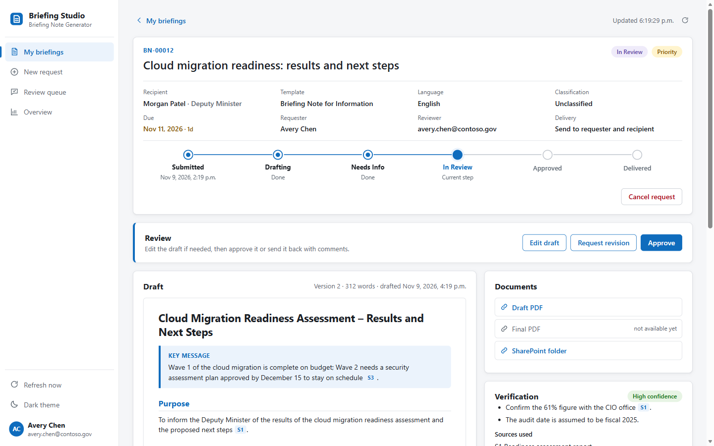
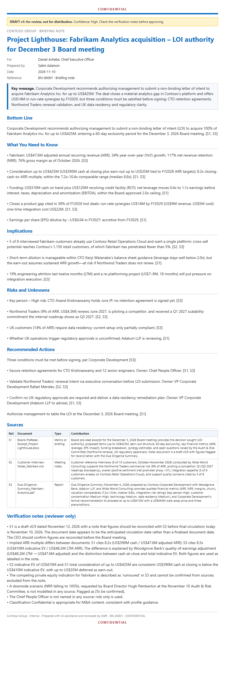

# Briefing Note Generator

> [!CAUTION]
> **Disclaimer**
>
> This accelerator is provided **"as is"**, without warranty of any kind. It's a personal sample, **not an
> official Microsoft product**, and Microsoft Support doesn't support it.
>
> **Neither Microsoft nor the author is responsible** for how you use this tool or for any impact it has on your
> environment, including but not limited to:
>
> - **Data:** the agents and workflows create and update Dataverse records, SharePoint files, Teams messages and
>   emails. Source documents you upload are stored in Dataverse.
> - **Credit consumption:** both agents run on the Copilot Studio **GitHub Copilot harness** and consume **Copilot
>   Credits** for building, testing, every intake conversation and **every draft** (about 4–7 minutes of agent work
>   per draft). Set a credit cap.
> - **Database capacity:** Dataverse storage used by requests, extracted text, files and run history.
> - **Content:** briefing notes are **AI-assisted drafts for human review**. They aren't advice. A person reviews and
>   approves every note before it's delivered. Check the verification notes, and don't process information above
>   the classification your environment is approved for.
>
> Review and test it in a non-production environment before any wider use. There's **no guarantee of updates, bug
> fixes or ongoing maintenance.**

Field staff often turn a stack of documents into a **briefing note** for a leader: a minister, a deputy minister, an
executive or a board. This accelerator lets them submit the documents and a few details. A **Copilot Studio agent**
drafts a cited note in the organization's format, and **asks the requester** when something essential is missing. A
reviewer edits and approves the draft. The final **PDF** is filed in SharePoint and sent by **email and Teams** to the
requester and the ultimate recipient.

It's built for **public-sector and private-sector** customers alike: the same engine runs with configurable *briefing
profiles* (style guide, glossary, classification guidance, filing location) and *note templates*.



---

## What it does

1. **Request.** The requester opens **Briefing Studio** (code app), or chats with the **Briefing Assistant** in Teams
   or Microsoft 365 Copilot. They pick a template, name the recipient, state the purpose, choose the language,
   classification and due date, and upload the source documents (PDF, Word or text). The text is extracted and saved
   with each document as S1, S2… The request gets an ID such as `BN-00042`.
2. **Draft.** The **BN 1 - Draft Briefing Note** workflow (a Copilot Studio workflow) runs the **Briefing Note
   Writer**, an agent on the GitHub Copilot harness. The Writer reads the request, every source document, the template
   and the profile, then either:
   - **asks for clarification.** When the note would be wrong without an answer (for example a decision note with no
     options, or contradictory figures that change the bottom line), it writes 1–3 specific questions to the request.
     The requester gets a Teams message and an email. They answer in Briefing Studio or through the Briefing
     Assistant, and drafting resumes automatically (at most two rounds); or
   - **writes the note.** It follows the template's sections in order, cites every fact `[S1]`, and records the
     sources used, **verification notes** (discrepancies between documents, assumptions, "[To be confirmed]" items)
     and a confidence level.
3. **Review.** The workflow renders a **draft PDF** (draft banner, verification notes) to SharePoint and sends it to
   the reviewer by email and Teams. In Briefing Studio, the reviewer can edit any section, then **Approve** or
   **Request revision** with comments; a revision goes back to the Writer, which applies the comments.
4. **Deliver.** **BN 2 - Deliver Briefing Note** renders the **final PDF**, with the classification marking at the top
   and bottom. It files the PDF in SharePoint and sends a **prebuilt email** (cover note, key message, PDF attached)
   and a **Teams message** to the requester and, depending on the delivery mode, the ultimate recipient.

```
Draft → Submitted → Drafting ─┬─► Needs Info ──(requester answers)──► Info Provided ─► Drafting …
                              └─► In Review ─┬─► Revision Requested ─► Drafting …
                                             └─► Approved ─► Delivered          (any failure → Needs Attention)
```

Every step is logged as a **Briefing Activity** (who, what, when, how long), shown as a timeline in both apps.



### Why an agent plus workflows

- **The agent does the reasoning** (Option A): it reads messy, multi-document input, decides whether it has enough to
  write, and writes in the organization's voice. A human comes in **only when needed**, through the record rather than
  a chat: the Writer runs unattended, writes its questions to the request, and is restarted when they're answered.
- **Workflows do what must happen every time:** status changes, rendering, filing, sending, logging and failure
  handling. GitHub Copilot harness agents can't be called from Power Automate cloud flows, so the workflows are
  **Copilot Studio workflows** that call the agent through the **agent node** (*Run an agent*).
- **Documents are rendered by the workflow** from what the agent saves in Dataverse (HTML, then OneDrive *Convert
  file*, then PDF in SharePoint). Every note looks the same, and the agent doesn't spend credits laying out files.

## What's in the box

| Piece | Description |
| --- | --- |
| **Dataverse** | 5 tables: *Briefing Request* (`BN-#####`), *Source Document* (file column + extracted text), *Briefing Activity* (timeline), *Briefing Profile* and *Note Template* (configuration). Also 13 global choices and 2 environment variables |
| **Security roles** | *Briefing Requester* (own requests), *Briefing Reviewer* (all requests), *Briefing Admin* (everything, including configuration) |
| **Copilot Studio agents** (GitHub Copilot harness) | **Briefing Note Writer**: one skill (*draft-briefing-note*) and the Dataverse MCP Server tool (read, describe, update). **Briefing Assistant**: four skills (*submit-briefing-request*, *check-my-briefings*, *answer-clarification*, *review-briefing*), the Dataverse MCP Server and Office 365 Users *Get my profile (V2)*. It accepts file attachments in chat |
| **Copilot Studio workflows** | *BN 1 - Draft Briefing Note*, *BN 2 - Deliver Briefing Note* |
| **Code app** | **Briefing Studio**: *My briefings*, *New request* (in-browser text extraction for PDF, Word and text), *Request detail* (status tracker, answering clarifications, draft with citation chips, verification notes, PDFs, timeline, edit/approve/revise), *Review queue*, *Overview* |
| **Model-driven app** | **Briefing Notes Hub**: the back office. *Briefing Overview* dashboard (5 charts and work lists), request views (Active, My, Needs Info, In Review, Approved/Delivered, Needs Attention, Overdue, All), a request form with Request, Clarifications, Draft, Delivery, Source documents and Timeline tabs, and the configuration tables |
| **Canvas app (source)** | **Briefing Board**: a read-only kanban board, a filterable list, a request detail and an overview over the same tables, in `canvas-board/`. It ships with mock data and a Dataverse loader; see [`docs/canvas-board.md`](docs/canvas-board.md). It isn't in the solution package yet |
| **Configuration (seed data)** | Two profiles, *Ministry of Digital Government* (public sector) and *Contoso Group* (private sector); five templates: *Briefing Note for Information*, *Briefing Note for Decision*, *Meeting or Event Brief*, *Issue Note*, *Executive Summary (one page)* |
| **Demo kit** | `samples/`: four fictional scenarios (cloud migration decision, minister's stakeholder meeting, vendor data-breach issue note, Contoso acquisition executive summary), each with 3 documents that contain deliberate discrepancies, and a seller demo script |
| **Connection references** | Dataverse (agents + workflows), Office 365 Users, Agent node, SharePoint, Teams, Outlook, OneDrive (PDF rendering) |

## Repository layout

```
agent/        The two Copilot Studio agent workspaces (GitHub Copilot harness), generated by scripts/build_agents.py
canvas-board/ Briefing Board canvas app source (.pa.yaml); see docs/canvas-board.md
code-app/     Briefing Studio (React + TypeScript + Vite code app); see code-app/README.md
docs/         plan.md (build plan and decisions), concept.md (use case and architecture rationale)
evals/        Briefing Assistant test set (Evaluate tab CSV) and Writer end-to-end scenarios
flows/        Readable workflow definitions, generated by scripts/build_workflows.py
packages/     Managed and unmanaged solution zips, plus deploymentSettings.example.json
samples/      Fictional demo documents and the demo script (samples/README.md)
scripts/      Schema as code and the build scripts (see below)
solution/     Unpacked Dataverse solution source
screenshots/  Images for this README
```

| Script | Purpose |
| --- | --- |
| `schema_def.py` | Single source of truth: tables, columns, choices, relationships, roles, environment variables |
| `create_schema.py`, `create_roles.py` | Deploy the schema and the roles into the solution (idempotent) |
| `seed_data.py` | The two profiles and five templates (idempotent upserts); `--site-url` sets the SharePoint site |
| `ensure_connections.py`, `create_connrefs.py` | Connections and neutral connection references |
| `build_agents.py`, `push_agents.ps1` | Generate both agents' instructions, skills and tools from `schema_def.py`, push and publish |
| `build_workflows.py` | Generate and deploy the two Copilot Studio workflows |
| `create_mda.py` | Forms, views, charts, dashboard, site map and the model-driven app |
| `submit_sample.py` | Submit a sample scenario exactly like Briefing Studio does (demo data and smoke test) |
| `generate_samples.py` | Regenerate the fictional demo documents |
| `add_to_solution.py`, `export_solution.ps1` | Solution membership; managed and unmanaged export |
| `flow_runs.py` | Debugging: recent workflow runs and failing actions |

## Getting started

### Prerequisites

- A Power Platform environment with Dataverse and Copilot Studio, with **Copilot Credits** capacity (GitHub Copilot
  harness), and Power Apps **code apps** enabled.
- The **Dataverse MCP server** enabled for Copilot Studio (Power Platform admin center → Environment → Settings →
  Product → Features).
- Microsoft 365: a SharePoint site and document library for the notes, Exchange Online and Teams; and OneDrive for
  the account that owns the workflow connections (it's used as a scratch space to convert HTML to PDF).
- [Power Platform CLI](https://aka.ms/pac/install).

### Import the solution

Grab the zips from the [latest release](../../releases/latest) or `packages/`.

```powershell
pac auth create --name target --environment https://<your-env>.crm.dynamics.com/
copy packages\deploymentSettings.example.json deploymentSettings.json   # fill in your connection IDs
pac solution import --path packages\BriefingNoteGenerator_managed.zip --settings-file deploymentSettings.json
pac solution publish
```

Use the unmanaged zip (`BriefingNoteGenerator.zip`) for a development environment.

### After importing

1. **Connections.** Bind the eight connection references to connections owned by the account that runs the workflows.
2. **Configuration.** Run `python scripts/seed_data.py --site-url https://<tenant>.sharepoint.com/sites/<site>
   --reviewer <reviewer email>` (set `DATAVERSE_URL`, `TENANT_ID` and `SOLUTION_NAME` in `.env` first), or create
   your own *Briefing Profiles* and *Note Templates* in the Briefing Notes Hub. Each profile needs a SharePoint site
   URL, a library (for example `Shared Documents`) and a root folder (for example `Briefing Notes/MDG`).
3. **Agents.** Open **Briefing Note Writer** and **Briefing Assistant** in Copilot Studio, check that their tools have
   connections, and **publish** both. The draft workflow calls the *published* Writer. Add the Briefing Assistant to
   **Teams and Microsoft 365 Copilot** under *Channels*, and share it with requesters.
4. **Workflows.** Turn on *BN 1 - Draft Briefing Note* and *BN 2 - Deliver Briefing Note*.
5. **Environment variables.** Set *Briefing Notes Hub URL* (`brn_AppBaseUrl`) to
   `https://<env>.crm.dynamics.com/main.aspx?appid=<app id>` and *Briefing Studio URL* (`brn_StudioUrl`) to the code
   app's play link. They're used in notification links.
6. **Roles and sharing.** Assign *Briefing Requester*, *Briefing Reviewer* or *Briefing Admin* (with *Basic User*)
   and share both apps.
7. **Cost control.** Set a Copilot Credits cap for the agents (they're listed under the GitHub Copilot harness).
8. *(Optional)* In the maker portal, add `brn_requestnumber` as a **find column** on the Briefing Request quick-find
   view so users can search by BN number (the API rejects this change).

## Using it

**As a requester**
- **Start:** in Briefing Studio choose **New request**, or tell the Briefing Assistant *"I need a decision note for the
  Deputy Minister on…"* and attach your documents.
- **Answer:** if the writer has a question, you get a Teams message and an email. Answer under *Your input is needed*
  in Briefing Studio, or say *"Answer the questions for BN-00042"* to the assistant.
- **Follow:** *My briefings* shows the status and timeline; the final PDF arrives by email.

**As a reviewer**
- Open the **Review queue** (or the link in the email or Teams message). Read the draft, the sources and the
  **verification notes**, edit any section, then **Approve** or **Request revision** with comments. You can also
  review from Teams: *"Approve BN-00042"*.

**As an administrator**
- Use the **Briefing Notes Hub** to watch the *Needs Attention* and *Overdue* views and to manage profiles and templates.

**Presenting it:** [`samples/README.md`](samples/README.md) is the demo script. Scenario 1 (cloud migration decision)
or 3 (data-breach issue note) for public-sector audiences, scenario 4 (Contoso acquisition) for private-sector
audiences, and scenario 2 or a request with no documents to show the agent **asking** instead of inventing.

## Customizing

| To change | Edit | Then |
| --- | --- | --- |
| Templates: sections, guidance, length, writing rules | *Note Templates* in the Briefing Notes Hub (`Heading \| guidance \| max words` per line) | Nothing: the Writer reads them at run time |
| Tone, plain-language rules, acronyms, classification guidance, filing location, PDF colour and footer | *Briefing Profiles* | Nothing |
| The Writer's or the Assistant's behaviour | `scripts/build_agents.py` | `scripts/push_agents.ps1 -Publish` (use `-Fresh` if `pac copilot pull` fails) |
| PDF layout, notifications, statuses | `scripts/build_workflows.py` | `python scripts/build_workflows.py` |
| Data model | `scripts/schema_def.py` | `create_schema.py`, then `build_agents.py` (the agents' Dataverse contracts are generated) |
| Briefing Studio | `code-app/src` | see [`code-app/README.md`](code-app/README.md) |

## Testing

- **Evaluate tab:** import [`evals/briefing-assistant-single-turn.csv`](evals/briefing-assistant-single-turn.csv) in
  Copilot Studio → Briefing Assistant → **Evaluate**.
- **End to end:** run the scenarios in [`evals/writer-scenarios.md`](evals/writer-scenarios.md).
  `python scripts/submit_sample.py 04 --requester <you@contoso.com>` submits a sample exactly as Briefing Studio does.
- Verified live in the build environment: a first draft (scenarios 4 and 2), a clarification round (a decision note
  with no documents → Needs Info → answers → draft), a reviewer revision (v2 applied the comments), and delivery
  (final PDF in SharePoint, email with the PDF attached, Teams messages to the requester and the recipient).

## Notes and limitations

- **Drafting takes about 4–7 minutes** per request (the Writer reads every document). The apps refresh on their own.
- **Text extraction, no OCR.** Briefing Studio extracts text from PDF (with a text layer), Word and text files in the
  browser. The Briefing Assistant reads chat attachments (PDF, Word, PowerPoint, Excel, text) and saves their text,
  but not the original file. Scanned PDFs need OCR first.
- **The Writer runs as the workflow connection owner.** Its Dataverse MCP tool is limited to read, describe and update
  on the `brn_` tables (allowed tools plus instructions), but the connection owner's **security role** is the real
  boundary. The Briefing Assistant runs as the signed-in user, so the user's role applies.
- **Teams messages** come from the Flow bot in a 1:1 chat and need recipients in the same tenant. Emails are sent from
  the workflow connection owner's mailbox. A failed notification never fails a run.
- **"My briefings" matches on the sign-in address (UPN)** stored as the requester email.
- **Review actions in Briefing Studio** (edit, revise, approve) are shown only to the request's assigned reviewer
  (`brn_revieweremail`, defaulting to the profile's reviewer, then the requester). Security roles still decide who
  can read and write requests; administrators can also act from the Briefing Notes Hub.
- **Cancelling** is offered only while no workflow is working on the request (Draft, Needs Info, In Review, Needs
  Attention). Both workflows re-check the status after the agent runs and stop without writing or sending anything
  if the request was cancelled meanwhile.
- **Classification:** the marking is applied to the PDF; Purview sensitivity labels aren't. Only process
  information your environment and AI configuration are approved for.
- Agent-authored Word files aren't used: GitHub Copilot harness agent files don't come back to workflows, so the
  deliverable is the workflow-rendered PDF plus the editable sections in the apps.

Out of scope by design: OCR, Purview labelling, multi-stage approval chains and translation of an approved note into
the other official language. The data model leaves room for them.

## License

MIT. Provided as is; see the disclaimer at the top of this page.
